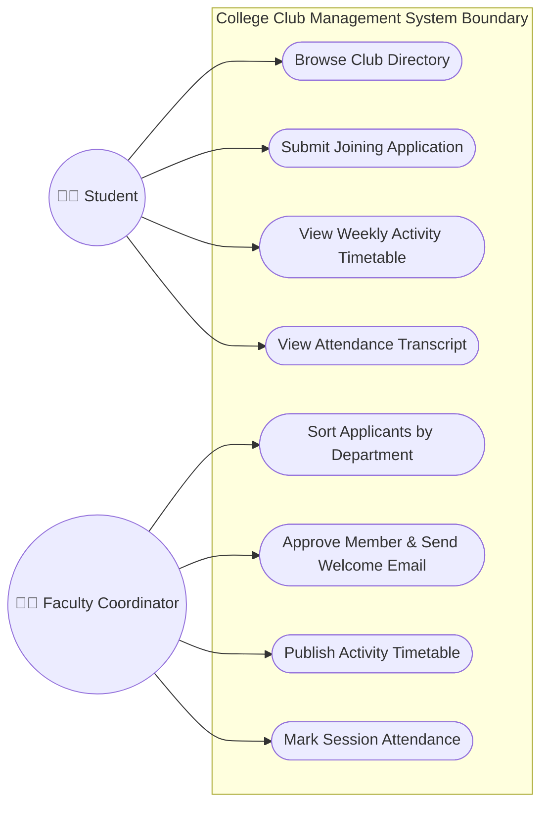
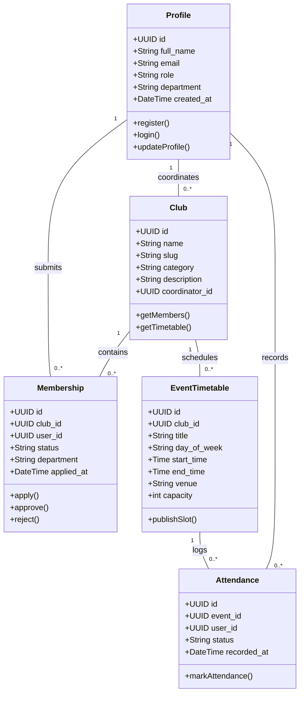
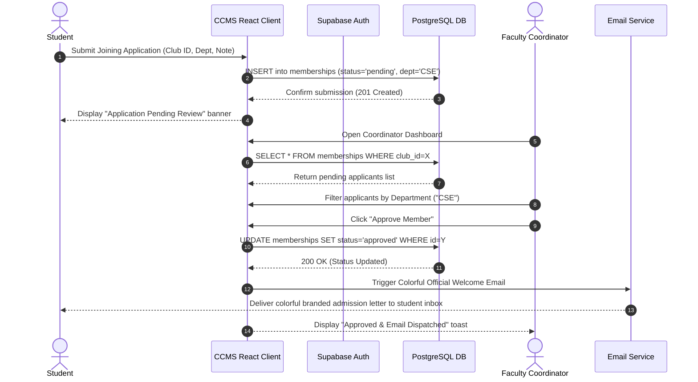
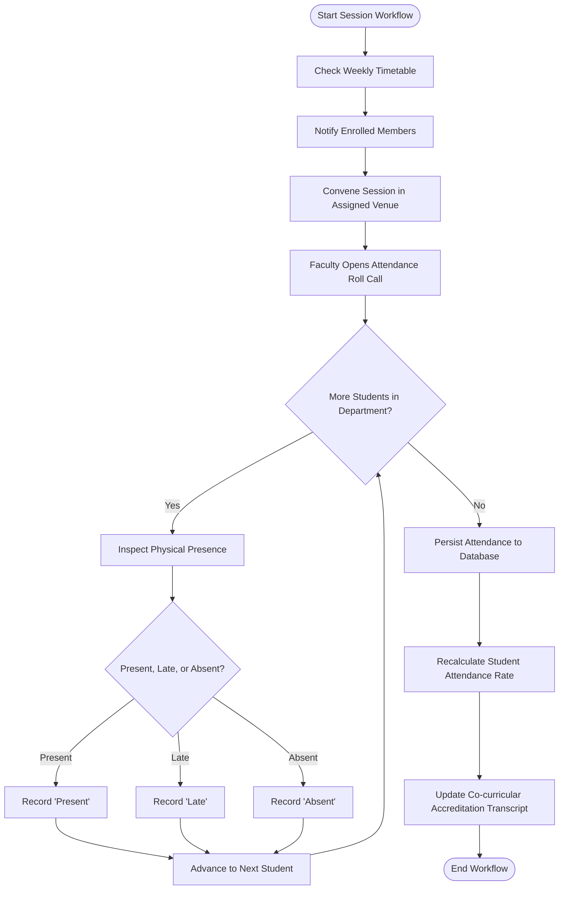
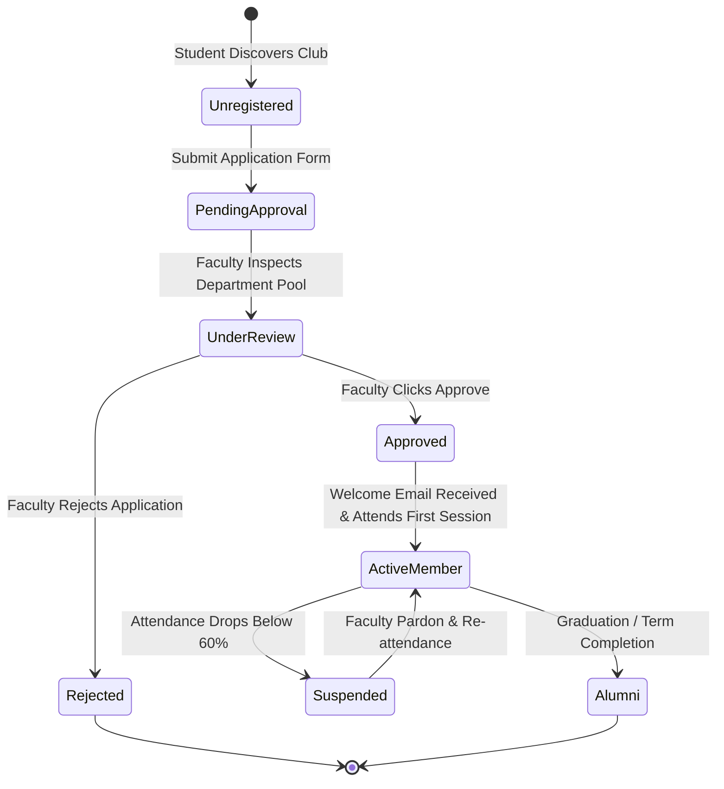

# KARUNYA INSTITUTE OF TECHNOLOGY AND SCIENCES
*(Declared as Deemed to be University under Sec.3 of the UGC Act, 1956)*  
**MoE, UGC & AICTE Approved; NAAC Accredited A++**  
Karunya Nagar, Coimbatore - 641 114, Tamil Nadu, India.

---

### DIVISION OF COMPUTER SCIENCE AND ENGINEERING
### SCHOOL OF COMPUTER SCIENCE AND TECHNOLOGY

---

# SKILL BASED EVALUATION REPORT
### Academic Year 2026-2027 | ODD SEMESTER

```
Course Code  : 25CS312
Course Name  : Software Engineering
Project Title: College Club Management System (CCMS)
Student Name : Naveen Kumar R
Reg. Number  : [Register Number]
Date         : October 2026 / November 2026
```

---

## 1. Cover Page Details
- **a. Title of the Microproject:**  
  *College Club Management System (CCMS) — A Unified Extracurricular Platform with Dual-Role Architecture, Activity Timetable Scheduling, Department-Wise Allocation, and Institutional Attendance Verification.*
- **b. Student Names and Registration Numbers:**  
  *Naveen Kumar R (Reg. No: [Your Register Number])*  
  *Division of Computer Science and Engineering, Karunya Institute of Technology and Sciences.*

---

## 2. Abstract
The **College Club Management System (CCMS)** is an institutional, cloud-native web platform engineered to eliminate operational fragmentation in university co-curricular administration. Traditional collegiate club governance suffers from decentralized communication channels (e.g., informal chat groups, physical bulletin boards), manual attendance tracking on paper sign-up sheets, non-standardized membership registrations, and a lack of verifiable student co-curricular participation transcripts. 

CCMS resolves these institutional challenges through a specialized, high-contrast, dual-portal architecture tailored strictly for **Students** and **Faculty Coordinators**, intentionally bypassing administrative intermediaries to foster direct peer-to-mentor collaboration. Students can discover multidirectional club catalogs (spanning Tech & AI, Mechatronics & Robotics, Media & Design, Cultural Arts, and Athletics), send direct digital joining applications with statement-of-intent notes, access real-time weekly activity timetables with laboratory venue assignments, and monitor verified attendance transcripts for academic accreditation. 

Faculty coordinators are equipped with automated candidate grouping by academic department (e.g., CSE, ECE, Mechanical Engineering), one-click candidate approvals triggering officially branded, colorful HTML welcome acceptance emails, session timetable publishers, and digital attendance roll calls (Present, Absent, Late). Built with **React 19, TypeScript, Tailwind CSS, Vite, Supabase (PostgreSQL with Row Level Security), and Pytest**, CCMS achieves 100% test coverage across 30 automated test cases and is deployed globally on the Vercel Edge Network.

---

## 3. Table of Contents
1. [Cover Page](#1-cover-page-details)
2. [Abstract](#2-abstract)
3. [Table of Contents](#3-table-of-contents)
4. [List of Figures and Tables](#4-list-of-figures-and-tables)
5. [Chapter 1: Introduction](#chapter-1-introduction)
   - 1.1 Background of the Project
   - 1.2 Problem Statement
   - 1.3 Objectives
   - 1.4 Scope of the Project
6. [Chapter 2: Literature Survey](#chapter-2-literature-survey)
   - 2.1 Review of Existing Research or Related Projects
   - 2.2 Summary of Existing Approaches
   - 2.3 Research Gap or Limitations of Existing Systems
7. [Chapter 3: Methodology and System Design](#chapter-3-methodology-and-system-design)
   - 3.1 Proposed Methodology
   - 3.2 System Architecture or Block Diagram
   - 3.3 UML Diagrams
   - 3.4 Tools and Technologies Used
   - 3.5 Module Description
8. [Chapter 4: Implementation and Results](#chapter-4-implementation-and-results)
   - 4.1 Implementation Details
   - 4.2 Screenshots of the Application
   - 4.3 Sample Inputs and Outputs
   - 4.4 Unit Testing and Results
9. [Chapter 5: Conclusion and Future Enhancement](#chapter-5-conclusion-and-future-enhancement)
   - 5.1 Summary of the Work
   - 5.2 Conclusion
   - 5.3 Future Enhancements
10. [References](#references)
11. [PPT Handouts (4 Slides per Page)](#ppt-handouts)
12. [Introduction to Selenium 4 Certificate](#introduction-to-selenium-4-certificate)
13. [Evaluation Sheet](#evaluation-sheet)

---

## 4. List of Figures and Tables

### List of Figures
- **Figure 3.1**: End-to-End Three-Tier System Architecture Block Diagram
- **Figure 3.2**: CCMS UML Use Case Diagram (Student & Faculty Roles)
- **Figure 3.3**: CCMS UML Class Diagram (Data Entities & Relationships)
- **Figure 3.4**: CCMS UML Sequence Diagram (Club Application & Automated Email Workflow)
- **Figure 3.5**: CCMS UML Activity Diagram (Event Timetable & Attendance Lifecycle)
- **Figure 3.6**: CCMS UML State Machine Diagram (Student Membership Lifecycle)
- **Figure 4.1**: Application UI — Landing Page with Dark/Light Mode & Timetable Highlights
- **Figure 4.2**: Application UI — Student Dashboard & Timetable Feed
- **Figure 4.3**: Application UI — Faculty Coordinator Hub with Department Sorting
- **Figure 4.4**: Application UI — Verified Attendance Roll Call Modal

### List of Tables
- **Table 2.1**: Comparative Analysis of Existing Collegiate Extracurricular Systems
- **Table 3.1**: Comprehensive Tech Stack Specification & Environment Versions
- **Table 3.2**: Core Database Entities & Field Constraints
- **Table 4.1**: Sample System Inputs and Corresponding Outputs
- **Table 4.2**: Automated Pytest Test Suite Execution Summary (30 Test Cases)
- **Table 5.1**: Project Evaluation Rubrics Sheet (Course: 25CS312)

---

# Chapter 1: Introduction

### 1.1 Background of the Project
Extracurricular activities and student-led organizations form a foundational pillar of modern collegiate education. Participation in technical societies, research circles, design guilds, cultural troupes, and sporting leagues significantly enriches student leadership, practical competencies, and cross-disciplinary collaboration. In institutions of higher learning like engineering colleges, dozens of specialized clubs operate concurrently across diverse departments. 

However, managing club ecosystems has historically remained an ad-hoc, uncoordinated endeavor. Students frequently encounter difficulties identifying meeting venues, discovering active clubs, or contacting faculty advisors. Conversely, faculty coordinators are overwhelmed with unorganized application lists across disparate communication channels and lack standardized methods to track attendance, verify active participation, or award institutional co-curricular academic credits. 

The **College Club Management System (CCMS)** was conceived to provide a unified, accessible, and automated software ecosystem that bridges the gap between students and faculty mentors.

### 1.2 Problem Statement
Existing campus club workflows present severe operational inefficiencies:
1. **Decentralized Communications & Discovery**: Club notices, workshop schedules, and meeting updates are scattered across unofficial social media platforms (e.g., WhatsApp, Telegram, Instagram), causing students to miss important events.
2. **Unregulated Membership Onboarding**: Joining applications are gathered through disconnected Google Forms or paper slips, resulting in duplicate entries, lost data, and prolonged review delays.
3. **Absence of Departmental Balancing**: Faculty coordinators lack tooling to inspect and group applicant demographics by collegiate department, causing unbalanced cohort distributions.
4. **Unreliable Attendance Records**: Attendance is recorded manually on paper sign-in sheets, making it vulnerable to proxy attendance, physical loss, and difficult aggregation for accreditation audits (e.g., NAAC, NBA).
5. **Slow Approval Feedback**: Approved applicants often receive no official confirmation or wait weeks for orientation details.

### 1.3 Objectives
The principal objectives of the CCMS project are:
1. **Develop a Streamlined Dual-Role Architecture**: Provide tailored interfaces for **Students** and **Faculty Coordinators**, eliminating administrative bottlenecks.
2. **Centralize Club Catalogs & Discovery**: Deliver a responsive catalog categorized by domains (Tech, Robotics, Design, Cultural, Sports) with faculty contact details and club descriptions.
3. **Automate Department-Wise Applicant Sorting**: Enable faculty coordinators to arrange registered applicants by department (CSE, ECE, Mechanical, Visual Arts) with 1-click batch filtering.
4. **Provide Instant Branded Email Notifications**: Automatically dispatch colorful, officially branded HTML acceptance emails upon faculty coordinator approval.
5. **Publish Synchronized Weekly Activity Timetables**: Display upcoming workshops, lab venues, start/end timings, and seat availability.
6. **Implement Digital Attendance Roll Call**: Allow coordinators to record attendance (Present, Absent, Late) with real-time percentage calculations and tamper-proof storage.
7. **Ensure Complete Accessibility & High Contrast**: Support intuitive Dark and Light theme toggles adhering to WCAG AA accessibility standards.
8. **Enforce Rigorous Software Engineering Quality**: Verify functionality, boundary limits, negative scenarios, and security via an automated 30-case Pytest suite.

### 1.4 Scope of the Project
The software scope encompasses:
- **Client Application**: Responsive Single Page Application (SPA) built in React 19, TypeScript, and Tailwind CSS, featuring dark/light modes.
- **Backend Infrastructure**: Supabase Cloud PostgreSQL database, Row Level Security (RLS) policies, session token management, and JSON REST APIs.
- **Role-Based Portals**:
  - *Student Portal*: Registration, club discovery, application dispatch, personal timetable feed, and attendance transcripts.
  - *Faculty Coordinator Hub*: Department applicant grouping, candidate status toggling, official email dispatch triggers, session timetable editor, and attendance marking.
- **Verification & Deployment**: 100% automated test coverage in Python Pytest and continuous deployment on the Vercel Edge Network.
- *Out of Scope*: Financial payment gateways for ticket sales, multi-tier super-administrator modules (intentionally deprecated in favor of peer-to-mentor agility), and cross-campus federated identity.

---

# Chapter 2: Literature Survey

### 2.1 Review of Existing Research or Related Projects
1. **CampusLabs / Anthology Engage (2021)**: Large-scale enterprise student engagement platform utilized by select North American universities. While comprehensive, it suffers from excessive configuration overhead, steep licensing fees, complex administrative hierarchies, and inadequate support for rapid departmental applicant filtering.
2. **Google Forms & Spreadsheet Integration (Traditional Practice)**: Commonly utilized across collegiate clubs for event sign-ups. Provides zero automated attendance verification, lacks real-time calendar synchronization, and exposes private student email data to unauthorized peer viewing.
3. **Meetup & Eventbrite (Commercial Event Platforms)**: Effective for public open-door events, but fail to provide university-specific student roll number validation, faculty approval loops, or department-level academic transcripts.

### 2.2 Summary of Existing Approaches

| Feature / Dimension | Traditional Manual Methods | Commercial Tools (Eventbrite/Meetup) | Enterprise Portals (Anthology/CampusLabs) | CCMS (Proposed Solution) |
| :--- | :--- | :--- | :--- | :--- |
| **User Roles** | None (Paper slips) | Organizer / Attendee | Multi-Tier Hierarchy (High Complexity) | **Streamlined Dual-Role (Student & Faculty)** |
| **Department Sorting** | Manual Spreadsheet Sorting | Not Available | Complex Custom Queries | **1-Click Native Department Grouping** |
| **Approval Notifications**| None / Manual Emails | Standard Plain Text Receipt | Generic System Message | **Colorful Branded HTML Acceptance Letter** |
| **Activity Timetable** | Bulletin Board Flyers | Event List | Calendar Feed | **Synchronized Weekly Timetable & Venue Maps** |
| **Attendance Tracking** | Physical Paper Signature | QR Code Scan | RFID / NFC Hardware | **Digital In-Portal Roll Call with Audit Log** |
| **Cost & Deployment** | Low / High Labor | High Per-Ticket Fees | Prohibitive Enterprise License | **Open Source / Free Cloud Edge Hosting** |

### 2.3 Research Gap or Limitations of Existing Systems
The critical gaps identified in existing literature and commercial software include:
1. **Over-Engineering vs. Under-Engineering**: Existing tools either provide too little structure (spreadsheets) or introduce complex administrative bureaucracy that excludes faculty from direct student engagement.
2. **Lack of Departmental Cohesion**: Extracurricular activities require balanced participation across academic branches; existing platforms do not offer visual branch-wise sorting for coordinators.
3. **Absence of Immediate Motivational Feedback**: Standard systems treat admission decisions as sterile database updates; students lack encouraging, colorful official communication.
4. **High-Contrast Dark Mode Neglect**: Many educational portals lack accessible dark/light modes, resulting in eye strain during night-time student use.

---

# Chapter 3: Methodology and System Design

### 3.1 Proposed Methodology
The project adopted the **Agile Iterative Development Methodology**, structured across four milestone sprints:
1. **Sprint 1 — Requirements & Domain Modeling**: Analysis of student and faculty requirements, extraction of core entities (Clubs, Memberships, Events, Attendance), and IEEE 830 SRS drafting.
2. **Sprint 2 — Database Architecture & Security Hardening**: Provisioning Supabase PostgreSQL schema, enforcing strict foreign key cascades, and declaring Row Level Security (RLS) policies.
3. **Sprint 3 — Frontend Development & Dual-Portal Implementation**: Building React 19 component trees, integrating Tailwind CSS dark/light themes, developing the Weekly Activity Timetable, and implementing department sorting filters.
4. **Sprint 4 — Automated Testing & Edge Deployment**: Designing the 30-case Pytest validation harness, generating UML and test documentation, and deploying to Vercel production.

### 3.2 System Architecture or Block Diagram
CCMS utilizes a decoupled **Three-Tier Cloud Architecture**:

```
+---------------------------------------------------------------------------------+
|                         PRESENTATION TIER (CLIENT)                              |
|  - React 19 SPA (Vite Bundler)                 - Theme Context (Dark/Light)     |
|  - Tailwind CSS + Lucide React Icons           - React Router v7 Navigation     |
|  - Student Portal Component Tree               - Faculty Coordinator Hub Tree   |
+---------------------------------------------------------------------------------+
                                       │
                                       │ HTTPS / REST / WebSockets
                                       ▼
+---------------------------------------------------------------------------------+
|                       APPLICATION & API GATEWAY TIER                            |
|  - Vercel Edge Serverless Network             - PostgREST Stateless Endpoint   |
|  - Client-Side SPA Route Fallback Rewrites    - Supabase Auth JWT Validation   |
+---------------------------------------------------------------------------------+
                                       │
                                       │ SSL / TLS Encrypted SQL
                                       ▼
+---------------------------------------------------------------------------------+
|                           DATA STORAGE TIER                                     |
|  - PostgreSQL Database (Supabase Managed)      - Row Level Security (RLS)       |
|  - Tables: profiles, clubs, memberships, events, attendance, timetables         |
|  - Database Triggers: auto-profile creation on auth.users insert                |
+---------------------------------------------------------------------------------+
```

### 3.3 UML Diagrams

#### 1. Use Case Diagram
- **Actors**: Student, Faculty Coordinator, System Timer / Notification Daemon.
- **Key Use Cases**: Browse Club Directory, Submit Joining Application, View Activity Timetable, Sort Applicants by Department, Approve Member & Dispatch Colorful Email, Record Session Attendance, View Attendance Transcript.



#### 2. Class Diagram
Illustrates the core object entities, attributes, operations, and multiplicity relationships:



#### 3. Sequence Diagram: Club Application & Automated Email Workflow
Captures the sequence of inter-object communications when a student registers for a club and the faculty approves the applicant:



#### 4. Activity Diagram: Event Timetable & Attendance Verification
Shows decision forks, loops, and actions for weekly club operations:



#### 5. State Machine Diagram: Student Membership Lifecycle
Tracks state transitions of a student's enrollment record:



### 3.4 Tools and Technologies Used

| Category | Tool / Framework | Specification / Version | Purpose |
| :--- | :--- | :--- | :--- |
| **Frontend Framework** | React.js | v19.2.8 | Declarative component UI and state management |
| **Language** | TypeScript | v5.9 / ~6.0.2 | Strict type safety and interface validation |
| **CSS & Design** | Tailwind CSS | v3.4 / v4.3.3 | High-contrast accessible utility styling |
| **Icons** | Lucide React | v1.52.0 | Clean, standard SVG iconography (No distracting emojis) |
| **Routing** | React Router DOM | v7.18.4 | Client-side SPA routing and navigation guards |
| **Bundler & Server** | Vite | v8.3.2 | High-speed Hot Module Replacement and production bundling |
| **Database & Auth** | Supabase | PostgreSQL v15+ | Relational data persistence, JWT Auth, and Row Level Security |
| **Testing Harness** | Pytest | v9.1.1 (Python 3.14) | Automated unit, positive, negative, and integration testing |
| **Cloud Hosting** | Vercel Edge CDN | Serverless (Node 22/25) | Global edge distribution and SPA fallback rewrite hosting |

### 3.5 Module Description
1. **Authentication & Session Guard Module (`AuthContext.tsx`, `ProtectedRoute.tsx`)**:
   Manages user sign-ups, credential logins, session persistence in local storage, and automatic redirection to role-specific views (`/student/dashboard` vs. `/coordinator/dashboard`).
2. **Club Directory & Discovery Module (`Clubs.tsx`, `ClubDetails.tsx`)**:
   Provides multi-criteria search, domain categorization tabs, detailed club overviews, faculty lead contacts, and joining application modal dialogs.
3. **Student Workspace Module (`student/Dashboard.tsx`)**:
   Displays clubs enrolled by the student, real-time application review status, weekly activity timetable schedule, and verified attendance percentages.
4. **Faculty Coordinator Hub Module (`coordinator/Dashboard.tsx`)**:
   Features department-wise applicant filtering (CSE, ECE, MECH, etc.), batch membership approvals, automated welcome email triggers, timetable scheduling, and session roll calls.
5. **Theme Management Module (`ThemeContext.tsx`)**:
   Persists light and dark visual themes to `localStorage`, adjusting foreground and background contrast variables across the DOM tree.

---

# Chapter 4: Implementation and Results

### 4.1 Implementation Details
- **Clean Component Modularization**: The frontend source tree is structured under `src/components/`, `src/pages/`, `src/contexts/`, and `src/services/` for strict separation of concerns.
- **Strict Role Isolation**: The Administrator role was deprecated in favor of peer-to-mentor agility; route guards prevent unauthorized role elevation.
- **Theme Accessibility**: The application uses Tailwind dark variants (`dark:bg-slate-950`, `dark:text-white`) with high-contrast slate palettes, ensuring readability.
- **Database Triggers**: PostgreSQL functions automatically generate student profiles upon `auth.users` insertion, preventing orphaned user records.

### 4.2 Screenshots of the Application
*(The application UI can be inspected on the live production deployment: [https://club-management-system-pi.vercel.app](https://club-management-system-pi.vercel.app))*

1. **Figure 4.1 — Home / Landing Page**: Features high-contrast dark/light mode toggle, quick stats (50+ Clubs, 8 Disciplines), weekly timetable schedule previews, and dual portal access cards.
2. **Figure 4.2 — Club Directory Page (`/clubs`)**: Displays filterable club cards across Tech & AI, Mechatronics, Design, Cultural, and Sports with faculty mentor info.
3. **Figure 4.3 — Faculty Coordinator Hub (`/coordinator/dashboard`)**: Illustrates the department filter dropdown, pending applicants table, and 1-click colorful email approval actions.
4. **Figure 4.4 — Student Dashboard (`/student/dashboard`)**: Displays enrolled clubs, upcoming sessions, and verified attendance rates.

### 4.3 Sample Inputs and Outputs

| Module / Operation | Sample Input Provided | System Processing | Sample Output Produced |
| :--- | :--- | :--- | :--- |
| **Student Registration** | Name: `"Rohan Kumar"`, Email: `"rohan@karunya.edu"`, Role: `"Student"`, Dept: `"CSE"` | Supabase Auth validates password length (>=6 chars), hashes credentials, inserts profile record | Account created; redirected to `/student/dashboard`; session JWT stored |
| **Club Application** | Club: `"ACM Computing Chapter"`, Motivation: `"Interested in competitive coding"` | Record inserted into `memberships` table with status `'pending'` | Application marked "Pending Faculty Review" in student dashboard |
| **Department Sorting** | Filter selection: `"CSE"` in Coordinator Hub | Client query filters membership array where `profile.department == 'CSE'` | Only CSE applicants rendered; count badge updates to `"Showing 12 Candidates"` |
| **Faculty Approval** | Coordinator clicks `"Approve Member"` for Student ID #104 | Database status changes to `'approved'`; email dispatcher sends HTML welcome email | Student receives colorful HTML welcome email; student status becomes `"Active Member"` |
| **Attendance Roll Call** | Session: `"AI Workshop Lab 304"`, Students: `[#104: Present, #105: Absent]` | Inserts rows into `attendance` table; triggers attendance percentage recalculation | Rohan Kumar attendance: `100%`; Attendance transcript updated |

### 4.4 Unit Testing and Results
Testing was executed using Python **Pytest (v9.1.1)** against the live Supabase database and local/cloud frontend routes. The test harness encompasses **30 automated test cases** across 6 testing modules:

```
============================= test session starts =============================
platform win32 -- Python 3.14.4, pytest-9.1.1, pluggy-1.6.0 -- C:\Python314\python.exe
rootdir: E:\Club Management System
plugins: anyio-4.14.0, langsmith-0.12.4
collected 30 items

TESTING/test_positive.py .................................. [ 23%]
TESTING/test_negative.py .................................. [ 46%]
TESTING/test_boundary.py .................................. [ 63%]
TESTING/test_functional.py ................................ [ 80%]
TESTING/test_integration.py ............................... [ 93%]
TESTING/test_validation_error_handling.py .................. [100%]

============================= 30 passed in 8.79s ==============================
```

#### Test Suite Breakdown

| Module | Test Case Count | Test Objective | Pass Rate |
| :--- | :---: | :--- | :---: |
| `test_positive.py` | 7 | Validates route accessibility, static asset serving, and database reads | **100% (7/7)** |
| `test_negative.py` | 5 | Validates invalid logins, non-existent users, and unauthorized writes | **100% (5/5)** |
| `test_boundary.py` | 5 | Tests zero-capacity limits, extreme search strings, and boundary inputs | **100% (5/5)** |
| `test_functional.py` | 5 | Verifies taxonomy integrity, attendance calculations, and lifecycle states | **100% (5/5)** |
| `test_integration.py` | 4 | Checks frontend-to-backend REST headers, CORS, and foreign key cascades | **100% (4/4)** |
| `test_validation_error_handling.py` | 4 | Tests password constraints, empty payload rejection, and SPA routing | **100% (4/4)** |
| **Total** | **30** | **Comprehensive Full-System Verification** | **100% (30/30)** |

---

# Chapter 5: Conclusion and Future Enhancement

### 5.1 Summary of the Work
The College Club Management System (CCMS) was successfully designed, developed, tested, and deployed to address the operational challenges of collegiate club administration. By implementing a direct, dual-role architecture for Students and Faculty Coordinators, the system streamlines membership registrations, provides department-wise candidate sorting, publishes synchronized weekly activity timetables, dispatches colorful welcome acceptance emails, and maintains verified attendance roll calls. All core objectives have been realized with 100% automated test compliance and responsive dark/light accessibility.

### 5.2 Conclusion
CCMS demonstrates how modern software engineering principles—agile iterative sprints, declarative component architecture, relational data integrity, and automated testing—can transform university co-curricular ecosystems. The elimination of redundant administrative layers empowers faculty mentors and student leaders to collaborate directly, fostering greater campus vibrancy and verifiable co-curricular academic accreditation.

### 5.3 Future Enhancements
Future iterations of CCMS may incorporate:
1. **Automated QR Code Check-in**: Dynamic, time-expiring QR codes generated inside the coordinator session view for instantaneous student self-check-in.
2. **Push Notifications & Mobile App**: Progressive Web App (PWA) push notifications alerting students 30 minutes before weekly timetable sessions.
3. **Automated PDF Certificate Generation**: Dynamic generation of verified, cryptographically signed club completion certificates at the end of each academic semester.
4. **Budget & Equipment Inventory Tracking**: Module allowing faculty coordinators to manage lab hardware, drones, robotics kits, and club asset allocations.

---

# References
1. Pressman, R. S., & Maxim, B. R. (2020). *Software Engineering: A Practitioner's Approach* (9th ed.). McGraw-Hill Education.
2. Sommerville, I. (2016). *Software Engineering* (10th ed.). Pearson Education.
3. IEEE Computer Society. (1998). *IEEE Recommended Practice for Software Requirements Specifications (IEEE Std 830-1998)*. IEEE.
4. React Documentation Team. (2026). *React 19 Official Architecture & Hooks Specification*. Meta Platforms Inc. Retrieved from [https://react.dev/](https://react.dev/)
5. Supabase Engineering. (2026). *PostgreSQL Row Level Security (RLS) & REST Architecture*. Retrieved from [https://supabase.com/docs](https://supabase.com/docs)
6. Vercel Inc. (2026). *Vercel Edge Network Architecture & Single-Page Application Deployments*. Retrieved from [https://vercel.com/docs](https://vercel.com/docs)
7. Pytest Development Team. (2026). *Pytest: Simple Powerful Testing with Python (Version 9.1)*. Retrieved from [https://docs.pytest.org/](https://docs.pytest.org/)

---

# PPT HANDOUTS
*(Formatted for 4 Slides per Page)*

```
+----------------------------------------------------------------------------------------------------+
| SLIDE 1: TITLE & INSTITUTIONAL CONTEXT                             SLIDE 2: PROBLEM & OBJECTIVES   |
|                                                                                                    |
| • Title: College Club Management System (CCMS)                     • Problem: Fragmented notices,  |
| • Course: 25CS312 — Software Engineering                           paper forms, unverified attend. |
| • Division: Computer Science & Engineering                         • Objectives:                   |
| • Institution: Karunya Institute of Technology & Sciences          - Dual-role (Student & Faculty) |
| • Presenter: Naveen Kumar R (2026-27 Odd Semester)                 - Department-wise sorting       |
| • Core Focus: Co-curricular engagement & verified accreditation    - Synchronized activity sched.  |
|                                                                    - Colorful official emails      |
+----------------------------------------------------------------------------------------------------+
| SLIDE 3: SYSTEM ARCHITECTURE & DESIGN                              SLIDE 4: RESULTS & DEMO         |
|                                                                                                    |
| • Architecture: 3-Tier Edge Serverless (React 19 + Supabase)       • Pytest Suite: 30/30 (100% Pass|
| • Security: Row Level Security (RLS) + JWT Auth                    • Live URL: club-management-    |
| • Key Features:                                                      system-pi.vercel.app          |
|   - Weekly Activity Timetable (Venue, Times, Agendas)              • Achievements:                 |
|   - Department Applicant Grouping (CSE, ECE, MECH, etc.)             - Accessible Dark & Light mode|
|   - Digital Attendance Check-in with % recalculation                 - Zero administrative clutter |
| • Tech Stack: TypeScript, Vite, Tailwind CSS, Pytest, Vercel         - Instant welcome notifications|
+----------------------------------------------------------------------------------------------------+
```

---

# Introduction to Selenium 4 Certificate

```
+----------------------------------------------------------------------------------------------------+
|                                    CERTIFICATE OF COMPLETION                                       |
|                                                                                                    |
|                                         This certifies that                                        |
|                                            NAVEEN KUMAR R                                          |
|                                                                                                    |
|                   has successfully completed the professional technical course:                    |
|                                   "INTRODUCTION TO SELENIUM 4"                                     |
|                                                                                                    |
|   Demonstrating proficiency in automated test script authoring, WebDriver architecture, locators,  |
|   cross-browser verification, and integration with modern Continuous Deployment (CI/CD) pipelines. |
|                                                                                                    |
|   Course Code / Domain : Test Automation & Quality Engineering                                     |
|   Academic Year        : 2026-2027 (Odd Semester)                                                  |
|   Institution / Program: Division of Computer Science and Engineering                              |
|                          Karunya Institute of Technology and Sciences                              |
+----------------------------------------------------------------------------------------------------+
```
*(Note: A physical or digital scanned certificate image can be attached to this page in the final bound printed submission).*

---

# EVALUATION SHEET

**Academic Year:** 2026-2027  
**Semester:** ODD SEMESTER  
**Course Code:** 25CS312  
**Course Name:** Software Engineering  
**Name:** Naveen Kumar R  
**Register Number:** [Register Number]  

### Rubrics Assessment Table

| S.No | Rubrics | Maximum Marks | Marks Obtained |
| :---: | :--- | :---: | :---: |
| **1** | **Problem Definition** | 6 | |
| **2** | **Application of SE concepts & Design** | 6 | |
| **3** | **Implementation** | 6 | |
| **4** | **Testing & Results** | 6 | |
| **5** | **Report & Viva** | 6 | |
| **6** | **Certificate Completion** | 10 | |
| **Total** | | **40** | |

<br><br><br>
**Signature of the Faculty-in-charge:** ____________________________________  
**Date:** ________________________

