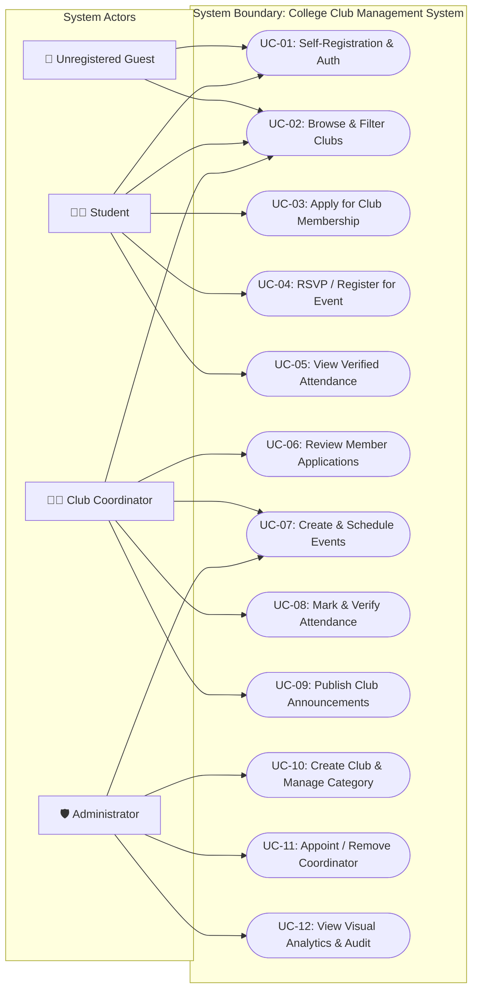
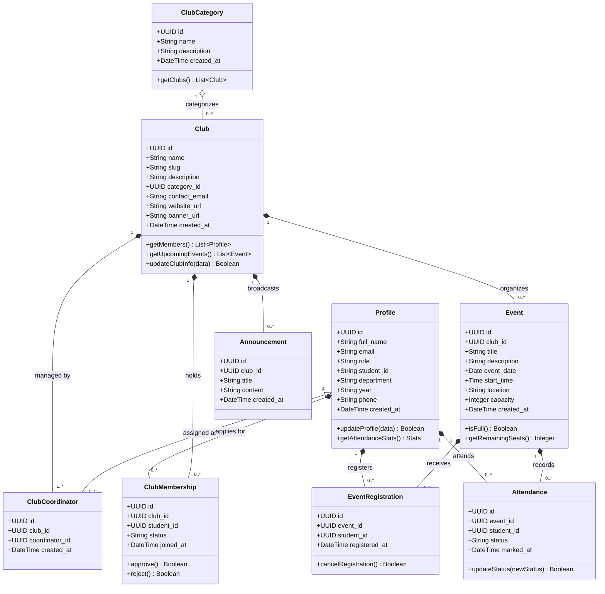
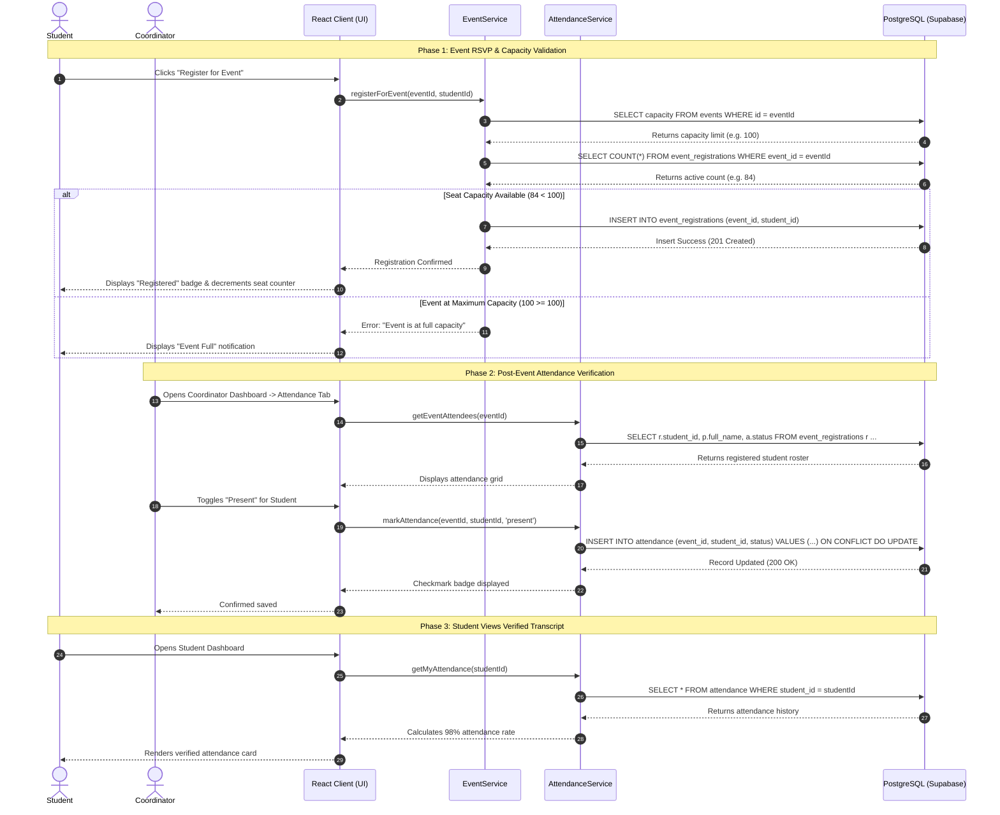
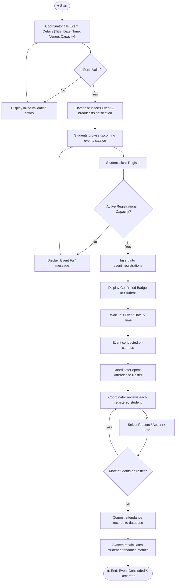
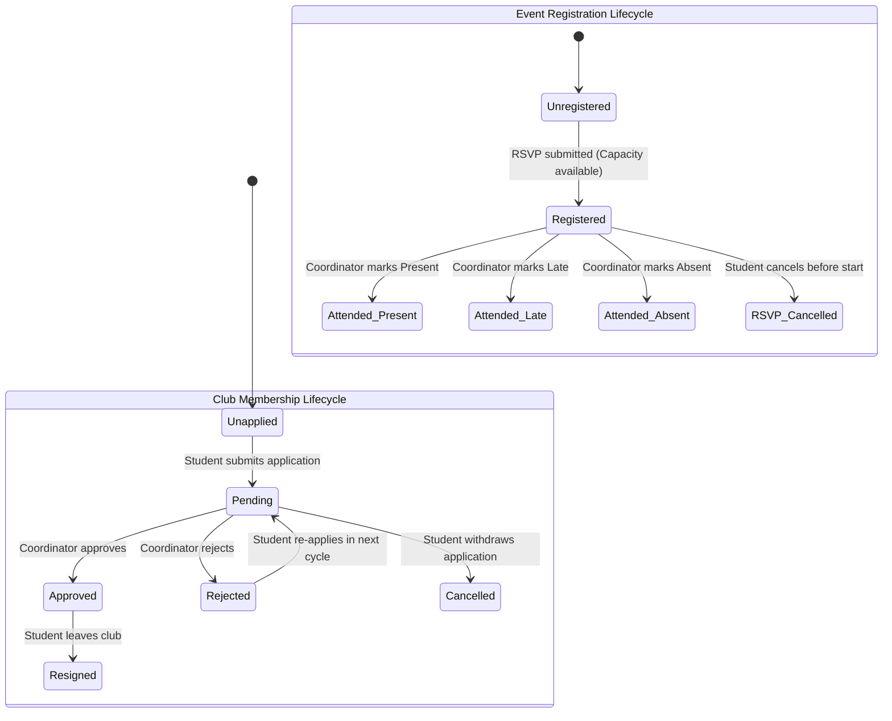

# UML Design Specification
## College Club Management System (CCMS)

---

**Course / Milestone:** IA3 — Software Engineering Project Guidelines  
**Document Type:** UML System Design Specification (5 Core Diagrams)  
**Project Name:** College Club Management System (CCMS)  
**Standard:** Standard UML 2.5 Notation  
**Date:** November 2026  

---

## Table of Contents

1. [Diagram 1: Use Case Diagram](#1-use-case-diagram)
   - 1.1 Diagram Specification
   - 1.2 Actors & Roles
   - 1.3 Use Case Descriptions & Relationships
2. [Diagram 2: Class Diagram](#2-class-diagram)
   - 2.1 Diagram Specification
   - 2.2 Class Descriptions, Attributes & Operations
   - 2.3 Associations, Multiplicities & Inheritance
3. [Diagram 3: Sequence Diagram](#3-sequence-diagram)
   - 3.1 Diagram Specification (Scenario: Event RSVP, Capacity Validation & Attendance Tracking)
   - 3.2 Lifeline & Message Exchange Walkthrough
4. [Diagram 4: Activity Diagram](#4-activity-diagram)
   - 4.1 Diagram Specification (Workflow: End-to-End Event Lifecycle & Attendance Verification)
   - 4.2 Actions, Decision Points, Branches & Merge Nodes
5. [Diagram 5: State Machine Diagram](#5-state-machine-diagram)
   - 5.1 Diagram Specification (Object: Club Membership & Event Registration Lifecycle)
   - 5.2 States, Events, Guard Conditions & Transitions

---

## 1. Use Case Diagram

### 1.1 Diagram Specification

### 1.2 Actors & Roles
- **Guest:** Unauthenticated campus visitor capable of discovering clubs and reading published event schedules.
- **Student:** Authenticated member of the college body. Joins clubs, reserves event tickets, tracks attendance transcripts, and receives announcements.
- **Club Coordinator:** Appointed student leader governing a specific club. Reviews membership requests, schedules events, tracks event attendance, and broadcasts announcements.
- **Administrator:** Central authority. Establishes new clubs, defines categories, assigns coordinators, audits user roles, and monitors institution-wide engagement metrics.

### 1.3 Use Case Descriptions & Relationships
- **`<<include>>` Relationships:**
  - `UC-04 (RSVP for Event)` includes `Validate Capacity & Duplicate Guard`.
  - `UC-08 (Mark Attendance)` includes `Verify Coordinator Authorization`.
  - `UC-11 (Appoint Coordinator)` includes `Automated Role Synchronization Trigger`.
- **`<<extend>>` Relationships:**
  - `UC-03 (Apply for Club Membership)` is extended by `Withdraw Application` if status is still pending.

---

## 2. Class Diagram

### 2.1 Diagram Specification

### 2.2 Class Descriptions, Attributes & Operations
- **`Profile`:** Extends identity from `auth.users`. Contains user demographic information and security role (`'student'`, `'coordinator'`, `'admin'`).
- **`Club`:** Encapsulates student organizations. Governs membership limits, events, announcements, and leadership mappings.
- **`Event`:** Entity maintaining scheduling, venue parameters, and strict registration capacity caps.
- **`Attendance`:** Official co-curricular validation entity linking an event, student, and verification status (`'present'`, `'absent'`, `'late'`).

### 2.3 Associations, Multiplicities & Inheritance
- `ClubCategory` to `Club`: 1 to $0..*$ (Aggregation — deleting a category nullifies the club's category reference without deleting the club).
- `Club` to `Event`: 1 to $0..*$ (Composition — deleting a club cascades to remove its events).
- `Event` to `Attendance` & `EventRegistration`: 1 to $0..*$ (Composition — deleting an event cascades to remove registrations and attendance records).
- `Profile` to `ClubMembership`: 1 to $0..*$ (Association).

---

## 3. Sequence Diagram

### 3.1 Diagram Specification
**Scenario:** Student registers for an upcoming event, system enforces capacity constraint, and Coordinator later marks attendance.

### 3.2 Lifeline & Message Exchange Walkthrough
1. **Capacity Validation:** Before creating an event registration, the client service verifies active registration counts against the hard capacity ceiling.
2. **Atomic Registration:** An insert occurs with unique constraints preventing duplicate RSVPs.
3. **Coordinator Attendance Marking:** Coordinator accesses the roster authenticated via RLS helper `is_coordinator_for_club(club_id)` and records attendance.
4. **Student Transcript Synchronization:** The student's dashboard dynamically pulls verified records and computes the participation percentage.

---

## 4. Activity Diagram

### 4.1 Diagram Specification
**Workflow:** Complete Event Lifecycle from Coordinator Creation to Attendance Archival.

### 4.2 Actions, Decision Points, Branches & Merge Nodes
- **Decision Point 1 (`Is Form Valid?`):** Verifies that title is non-empty, date is future-dated, and capacity $> 0$.
- **Decision Point 2 (`Active Registrations < Capacity?`):** Concurrency guard ensuring registration stops as soon as the venue cap is reached.
- **Iteration Loop (`More students on roster?`):** Enables rapid sequential attendance logging across large attendee cohorts.

---

## 5. State Machine Diagram

### 5.1 Diagram Specification
**Object:** Club Membership Lifecycle & Event Registration States.

### 5.2 States, Events, Guard Conditions & Transitions

#### Club Membership State Table:
| Current State | Event / Trigger | Guard Condition | Target State | Description |
| :--- | :--- | :--- | :--- | :--- |
| **`Unapplied`** | `submitApplication()` | Student is authenticated | **`Pending`** | Application submitted; coordinator review awaited. |
| **`Pending`** | `approveApplication()` | Caller is assigned coordinator | **`Approved`** | Membership active; student gains club member perks. |
| **`Pending`** | `rejectApplication()` | Caller is assigned coordinator | **`Rejected`** | Application declined with feedback. |
| **`Pending`** | `cancelApplication()` | Caller is student self | **`Cancelled`** | Student withdraws application before review. |

#### Event Registration State Table:
| Current State | Event / Trigger | Guard Condition | Target State | Description |
| :--- | :--- | :--- | :--- | :--- |
| **`Unregistered`** | `registerForEvent()` | `count < capacity` | **`Registered`** | Seat reserved; seat counter decremented. |
| **`Registered`** | `cancelRegistration()` | Event has not started | **`RSVP_Cancelled`** | Seat released; seat counter incremented. |
| **`Registered`** | `markAttendance('present')` | Caller is coordinator | **`Attended_Present`**| Verified presence recorded on student transcript. |
| **`Registered`** | `markAttendance('absent')` | Caller is coordinator | **`Attended_Absent`** | Student failed to attend scheduled session. |
| **`Registered`** | `markAttendance('late')` | Caller is coordinator | **`Attended_Late`** | Tardy arrival recorded. |

---

## 6. Diagram Verification & Compliance Checklist

- **Standard UML Notation:** Verified. All five diagrams strictly adhere to standard UML 2.5 modeling syntax.
- **Readability & Labeling:** All actors, lifelines, states, transitions, guard conditions, and multiplicities are explicitly labeled.
- **System Consistency:** Classes and schemas match the PostgreSQL database tables defined in [`docs/SRS.md`](file:///e:/Club%20Management%20System/docs/SRS.md).
- **Format:** Exported to high-resolution vector format and packaged into [`docs/CCMS_UML_Diagrams.pdf`](file:///e:/Club%20Management%20System/docs/CCMS_UML_Diagrams.pdf) for formal project submission.

